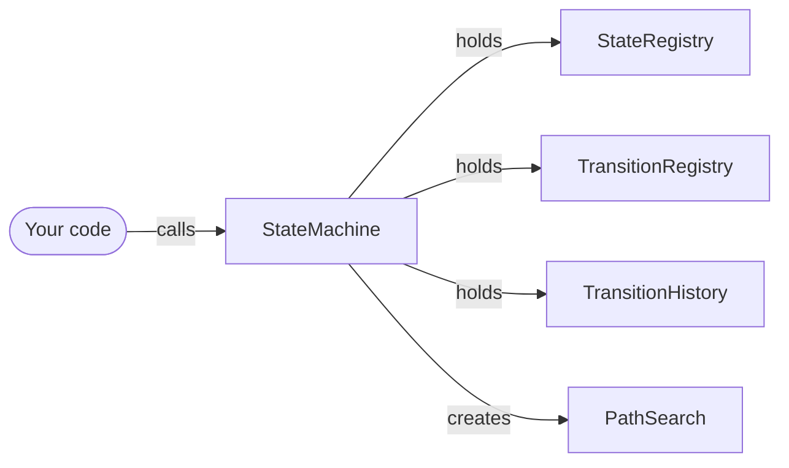
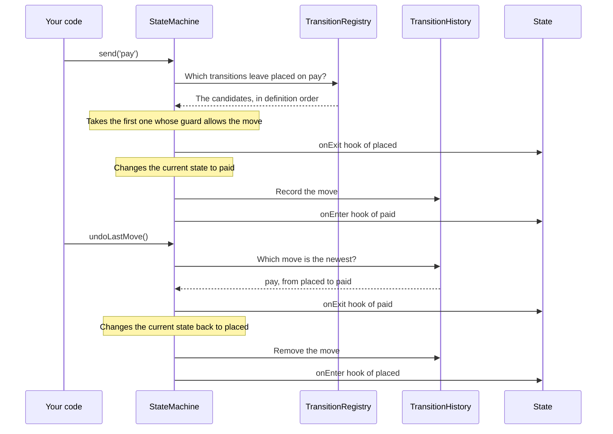
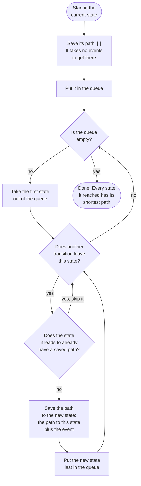
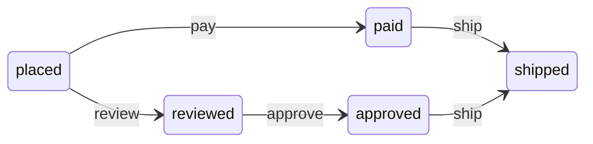

# Architecture

How flowstate-js works inside, for developers who want to read or change the code. To use the module, read the
[README](README.md).

The diagrams use [Mermaid](https://mermaid.js.org/).

## The parts

You only use `StateMachine`. It holds the other parts.

| Part                 | Job                                                                               |
| -------------------- | --------------------------------------------------------------------------------- |
| `StateMachine`       | The current state, the context and every public method.                           |
| `StateRegistry`      | The states. Each `State` has a name and its hooks.                                |
| `TransitionRegistry` | The transitions, in the order they were defined. Each `Transition` has its guard. |
| `TransitionHistory`  | The moves made so far, oldest first.                                              |
| `PathSearch`         | Finds the paths for `canReach` and `findPathTo`. Each call makes a new one.       |
| `names.js`           | Checks state and event names. A bad name gives a `TypeError`.                     |
| `errors.js`          | The error classes. They all extend `FlowStateError`.                              |

`src/index.js` exports only `StateMachine` and the errors.

## Sending an event and undoing it

A simple diagram that shows the flow at a high level, not every step in the code. The order moves from `placed` to
`paid` on `pay`, and then back.

- No candidate: `send` throws `NoTransitionError`.
- Every guard says no: `send` throws `BlockedTransitionError`.
- In both cases the machine stays where it is.
- `canSend` makes the same choice as `send`, but stops before the hooks.
- `undoLastMove` asks no guard. With an empty history, it does nothing.

Every step of `send` is in the README:
[What happens when you send an event](README.md#what-happens-when-you-send-an-event).

## Path search

Path search answers "can the machine still get to this state, and how?" It is mostly used to show the steps left in
a process, or to check if a goal is still possible, such as delivery after an order was cancelled.

Each call to `canReach` or `findPathTo` creates a new `PathSearch` from the current state. The search runs in the
constructor, so the answer always fits the state the machine is in now.

The algorithm is a breadth-first search (BFS). It visits every state one event away before any state two events
away, and so on.

Two words in the diagram:

- **Path:** the events that lead from the current state to a state, such as `['pay', 'ship']`.
- **Queue:** the states that have a saved path and wait for their turn. New states go in at the back, and the
  next state comes from the front.

When the search is done, `canReach` returns `true` if the state has a saved path, and `findPathTo` returns that path.
Without a saved path, `canReach` returns `false` and `findPathTo` throws `NoPathError`.

### Example

Two paths lead from `placed` to `shipped`. One has two events, the other has three.

A search from `placed`:

| Step | Visits     | New paths                               | Queue after           |
| ---- | ---------- | --------------------------------------- | --------------------- |
| 0    |            | `placed: []`                            | `placed`              |
| 1    | `placed`   | `paid: ['pay']`, `reviewed: ['review']` | `paid`, `reviewed`    |
| 2    | `paid`     | `shipped: ['pay', 'ship']`              | `reviewed`, `shipped` |
| 3    | `reviewed` | `approved: ['review', 'approve']`       | `shipped`, `approved` |
| 4    | `shipped`  | none                                    | `approved`            |
| 5    | `approved` | none, `shipped` already has a path      | empty                 |

`findPathTo('shipped')` returns `['pay', 'ship']`.

### Why the first path is the shortest

The queue gives out the states in the order they got a path. All states one event away come before the states two
events away. The first path saved for a state is the shortest one, and later paths to it are skipped. Each state
goes into the queue only once, so the search ends even when the machine has a cycle.

When two paths are equally short, compare them step by step from the start. At the first step where they differ,
the path whose transition was defined first wins.

### Design choices

- The search runs in the constructor. A `PathSearch` that exists has always finished.
- Guards are not asked. A guard depends on the context when the event is sent, and the search sends nothing. A path
  that is found can still be blocked: `send` may throw `BlockedTransitionError` on the way.
