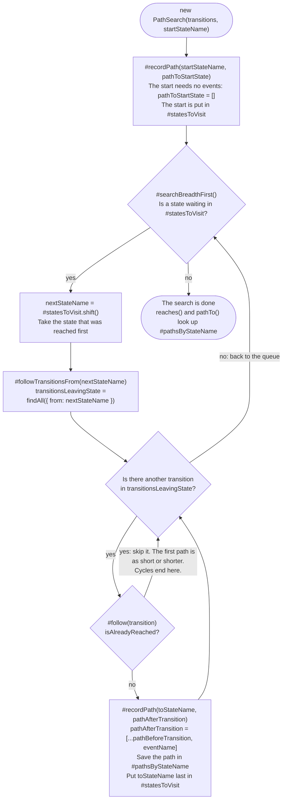
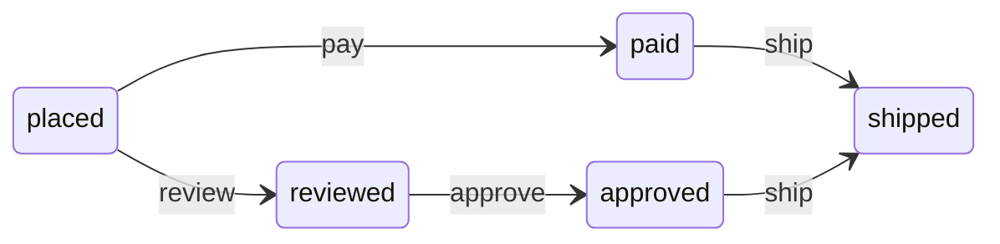

# Architecture

How flowstate-js works inside. To use the module, read the [README](README.md). This file is for
developers who want to read or change the code.

The diagrams use [Mermaid](https://mermaid.js.org/). GitHub shows them as pictures.

## Path search

`canReach` and `findPathTo` both create a new `PathSearch` (`src/PathSearch.js`) from the current
state. The search runs once, when the object is created. After that, `reaches(stateName)` and
`pathTo(stateName)` only look up the answer.

### The flow

### Example

Two chains lead from `placed` to `shipped`. One has two events, the other has three.

A search from `placed` runs like this:

| Step | State visited | Paths recorded                                | `#statesToVisit` after    |
| ---- | ------------- | --------------------------------------------- | ------------------------- |
| 0    | none          | `placed: []`                                  | `placed`                  |
| 1    | `placed`      | `paid: ['pay']`, `reviewed: ['review']`       | `paid`, `reviewed`        |
| 2    | `paid`        | `shipped: ['pay', 'ship']`                    | `reviewed`, `shipped`     |
| 3    | `reviewed`    | `approved: ['review', 'approve']`             | `shipped`, `approved`     |
| 4    | `shipped`     | none: no transition leaves `shipped`          | `approved`                |
| 5    | `approved`    | none: `shipped` was reached before, in step 2 | empty, so the search ends |

`pathTo('shipped')` returns `['pay', 'ship']`. The chain through `reviewed` and `approved` also
leads to `shipped`, but it is longer, and it comes later.

### Why the first path is the shortest

The queue hands out states in the order they were reached. All states one event away are visited
before any state two events away, and so on. This is called breadth-first search. When a state is
reached for the first time, no shorter path to it can come later. Every later path to it is
skipped, and that is also why the search ends when the machine has cycles.

If two paths are equally short, the first one found wins. `findAll` returns transitions in the
order they were defined, so the transitions defined first win.

### Design choices

- The search runs in the constructor. A `PathSearch` that exists has always finished its search,
  so there is no method that must be called first.
- The map of paths and the queue are fields. The private methods share them and do not pass them
  around as arguments.
- Guards are not asked. They depend on the context at the time of each move, so the search only
  looks at the structure of the machine.
